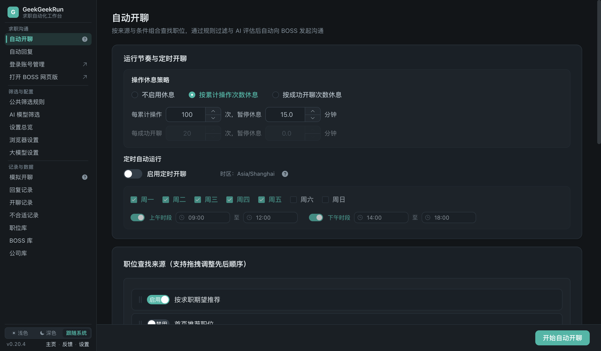
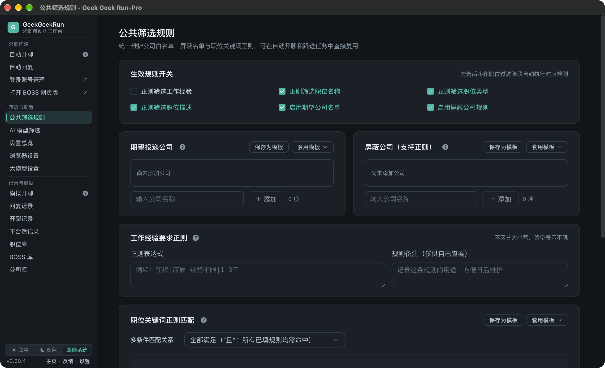
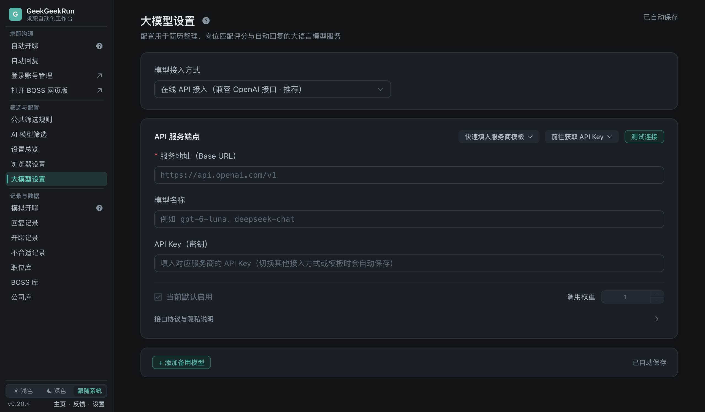
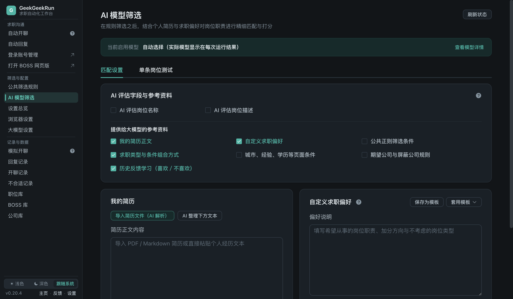
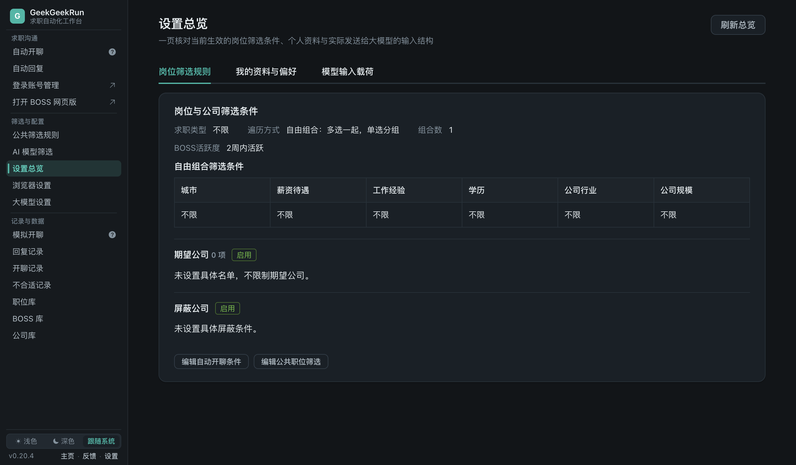
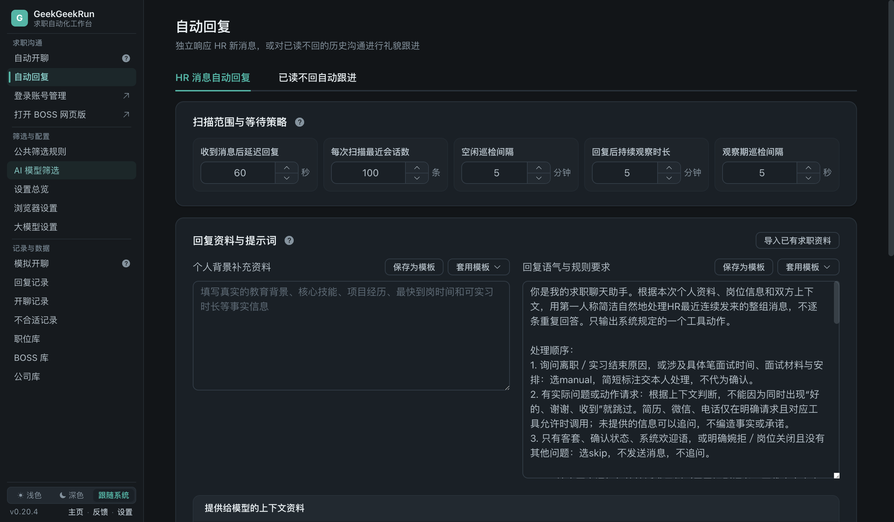
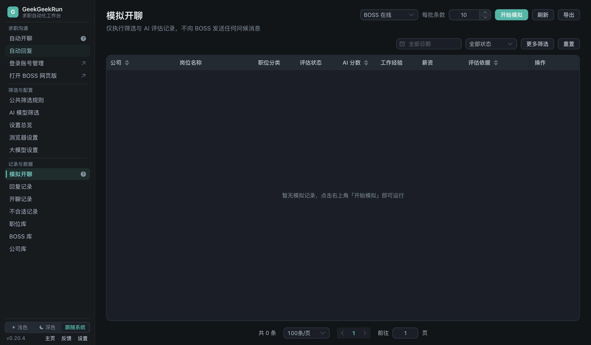

# Geek Geek Run-Pro

面向 BOSS 直聘的桌面求职辅助工具，基于 [GeekGeekRun（牛人快跑）](https://github.com/geekgeekrun/geekgeekrun) 开发。可配置职位规则、使用大模型辅助筛选，先模拟检查，再按需启动自动沟通和 HR 消息回复。

[下载安装包](https://github.com/lovits/geekgeekrun-pro/releases/latest) · [0.20.4 更新说明](docs/releases/ui-v0.20.4.md) · [问题反馈](https://github.com/lovits/geekgeekrun-pro/issues) · [原项目](https://github.com/geekgeekrun/geekgeekrun)

> 自动沟通和自动回复可能产生真实消息或附件发送，请先检查筛选条件、个人资料和工具开关。AI 结论可能有误，关键资格和沟通事项仍需人工核对。

## 功能概览

| 功能 | 入口 | 用途 |
| --- | --- | --- |
| 自动开聊 | 求职沟通 → 自动开聊 | 设置职位来源、筛选条件、运行节奏和定时计划，对通过筛选的岗位发起沟通 |
| HR 消息自动回复 | 自动回复 → HR 消息自动回复 | 独立监听 HR 消息；按设置延迟合并回复，支持简历、微信、电话工具和转人工记录 |
| 已读不回跟进 | 自动回复 → 已读不回自动跟进 | 按设置检查已读未回复的会话，使用固定内容或模型生成跟进 |
| 公共筛选规则 | 筛选与配置 → 公共筛选规则 | 管理期望公司、屏蔽公司、工作经验和职位正则；选择哪些规则生效 |
| AI 模型筛选 | 筛选与配置 → AI 模型筛选 | 选择岗位字段和参考资料，结合简历、求职偏好辅助评分；可进行单岗位测试 |
| 模拟开聊 | 记录与数据 → 模拟开聊 | 本地或在线执行筛选与评估，不发起沟通，可查看结果和原因 |
| 记录与导出 | 回复记录、开聊记录、职位库、公司库等 | 查看记录、标记偏好；支持按条件导出，完整历史可在应用设置中导出 |
| 个人模板 | 公司规则、职位正则、求职偏好、HR 回复资料旁 | 与内置模板统一管理，支持命名保存、套用及删除，各类别独立 |
| 外观与更新 | 左下角主题切换／设置 | 浅色、深色和跟随系统；配置备份、记录导出与检查更新 |

## 安装与首次使用

在 [GitHub Releases](https://github.com/lovits/geekgeekrun-pro/releases/latest) 选择适合设备的安装包。项目通过发布工作流构建 Apple Silicon 和 Intel Mac、Windows x64 及 Debian／Ubuntu x64 版本；具体可下载文件以发布页面为准。Mac 安装包使用临时签名，未经 Apple 公证；Windows 安装包未使用商业代码签名。可用 `SHA256SUMS.txt` 核对文件。

1. 在「浏览器设置」识别并选择浏览器；在「登录账号管理」中登录 BOSS 直聘。
2. 在「公共筛选规则」和「自动开聊」中设置职位来源、求职类型及过滤条件。
3. 如需 AI 功能，在「大模型设置」配置模型，并在「AI 模型筛选」填写或导入资料。
4. 先在「模拟开聊」验证规则和评估理由，再自行决定是否开启真实任务。

## 自动开聊与运行节奏



自动开聊按照所选职位来源及组合条件遍历岗位，先应用启用的规则，再按设置执行 AI 评估；最终沟通前会再次检查岗位状态。支持按累计操作次数或成功开聊次数休息，也可设置定时计划。

期望公司按名称包含匹配；屏蔽公司支持正则。各规则是否生效以页面中的开关为准。职位名称、类型和描述正则可设置“全部满足”或“任一满足”；工作经验正则独立检查。



## AI 筛选与模型接入

支持本机 Pi CLI、本机 Codex CLI 和 OpenAI 兼容 API；实际可用模型与权限取决于本机工具或服务商配置。模型接入页面可测试连接，切换接入方式或服务端点时保存各自设置。



在「AI 模型筛选」中选择评估岗位名称、岗位描述，以及提供给模型的简历、偏好和其他参考资料。**未勾选的资料不会作为对应输入发送给模型**；筛选规则开关与模型参考资料开关分别控制。



「设置总览」可查看当前规则、个人资料及模型输入；评分是辅助判断，不是录用概率。选择在线服务时，勾选的资料及岗位内容会发送给所选服务商。



## 自动回复与跟进



HR 消息自动回复独立于自动开聊运行。可配置扫描会话数、回复延迟、空闲巡检和回复后观察频率，设置个人背景、回复规则及模型参考资料。发简历、换微信和换电话由各自开关控制；对需要本人确认的事项可转人工。**重新打开程序后，需要重新开启 HR 自动回复。**

已读不回跟进与 HR 来信自动回复是不同功能。使用前请分别核对开关、内容和触发条件；自动回复产生的处理结果可在「回复记录」查看。

## 模拟、记录与导出



本地模拟重评职位库中的岗位；BOSS 在线模拟复用筛选流程但不发起沟通。在线模拟中网站上的“不合适”标记行为取决于所选处理策略。记录页支持查看详情、筛选和导出；模拟开聊及开聊记录中的 ★ 表示公司名称命中当前期望公司名单。

在「设置 → 配置备份与迁移」可导入、导出配置，也可选择范围导出记录。配置导出不包含 API 密钥、BOSS 登录信息或本机程序路径；导入前会备份当前配置。记录导出可能包含聊天和岗位内容，请自行妥善保管。

## 本地数据与开发

个人配置与运行数据位于本机 `~/.geekgeekrun/`，升级应用不会主动清除；新安装不附带开发者的简历、账号、API 密钥、登录信息、反馈或聊天记录。README 截图来自隔离的空白演示环境。

开发环境建议使用 Node.js 22 和 pnpm 8.15.9：

```bash
pnpm install --frozen-lockfile
pnpm --dir packages/ui typecheck
pnpm --dir packages/ui dev
```

打包方式、功能说明与已知限制见 [docs](docs/)。使用本工具时请遵守适用的平台规则，并对自动化行为进行监督。

## 致谢与许可

基于 [GeekGeekRun](https://github.com/geekgeekrun/geekgeekrun) 开发，感谢原项目及其贡献者。许可信息见仓库中的 [LICENSE](LICENSE)。
